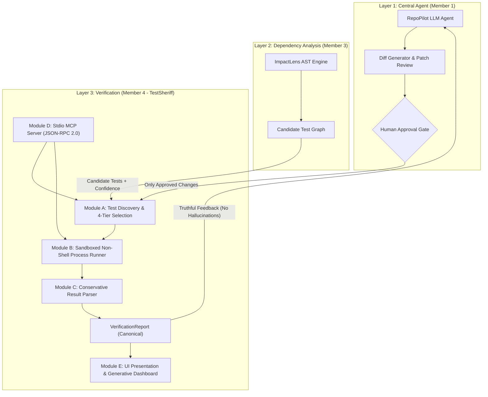
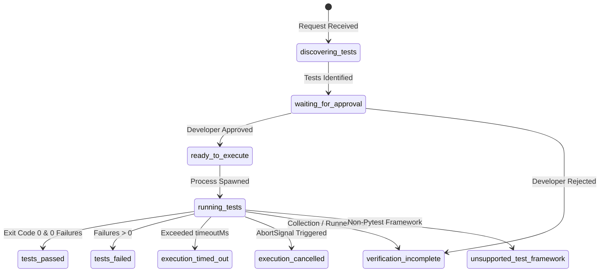

# RepoPilot AI — TestSheriff Architecture Specification
**Layer 3 Automated Test Discovery, Safe Execution & Verification**

---

## 1. System Topology & Layering

RepoPilot AI is structured into three discrete operational layers:

---

## 2. Execution State Machine

TestSheriff transitions through 10 deterministic states defined for Member 5's UI integration:

---

## 3. Four-Tier Test Selection Algorithm

To optimize speed without compromising verification integrity, TestSheriff selects tests via a prioritized multi-tier engine:

| Priority | Tier Name | Description | Source Tag | Default Confidence |
|---|---|---|---|---|
| **1** | **Explicit Tests** | Directly specified by the developer or agent workflow. | `explicit` | `high` |
| **2** | **ImpactLens Candidates** | Tests identified via AST and dependency graph impact analysis. | `impact` | `high` |
| **3** | **Conventional & Import-Based** | File name pairing (`test_<name>.py`) and static AST scanning of test file imports (`from module import ...`). | `convention` / `import` | `high` |
| **4** | **Repository Suite Fallback** | Broader workspace test discovery executed when no narrow mapping can be established. | `configuration` | `low` |

### Truthful Disclosure Rule
When Priority 1, 2, or 3 selects a targeted subset of tests, TestSheriff injects an explicit limitation into `VerificationReport.limitations`:
> *"Targeted subset of tests executed. Broader repository test suite was not run; untested edge cases may exist."*

---

## 4. MCP Communication Contract

TestSheriff exposes three canonical tools via JSON-RPC 2.0:
1. `discover_tests`: Inspects workspace test setups without executing code.
2. `run_tests`: Safely executes tests on allowlisted runners and returns a structured `VerificationReport`.
3. `get_test_results`: Retrieves cached reports by `requestId`.
